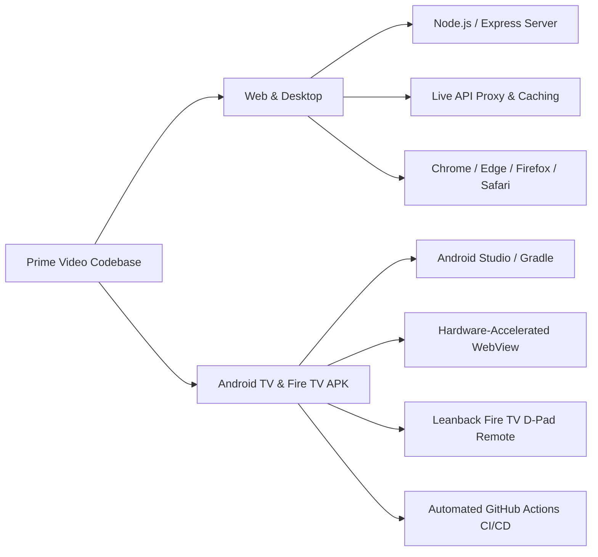

<div align="center">

# 🎬 Prime Video — Universal Multi-Platform Streaming Hub
### Next-Gen Web & Android TV Streaming Experience Powered by Live Aggregated APIs

[](https://github.com/ankitbhartii/Prime-video)
[](https://github.com/ankitbhartii/Prime-video)
[](https://github.com/ankitbhartii/Prime-video)
[](.github/workflows/build.yml)
[](LICENSE)

<br/>

<p align="center">
  <b>Prime Video UI/UX</b> reimagined as a <b>universal content aggregator</b>. Seamlessly explore, search, and stream trending movies, binge-worthy TV series, anime, and live channels aggregated across <b>Netflix</b>, <b>Disney+ Hotstar</b>, <b>Amazon Prime</b>, <b>HBO Max</b>, and <b>Box Office premieres</b>.
</p>

---

</div>

## 🌟 Highlights & Key Features

<table>
  <tr>
    <td width="50%">
      <h3>📺 Amazon Prime Video Obsidian UI</h3>
      <ul>
        <li>Authentic obsidian aesthetic with signature <b>Prime Cyan</b> (<code>#00a8e1</code>) accents and glow effects.</li>
        <li>Hero billboard with dynamic backdrops, badges, IMDb ratings, and direct play actions.</li>
        <li>Responsive vertical 2:3 portrait poster cards matching modern streaming standards.</li>
      </ul>
    </td>
    <td width="50%">
      <h3>🌐 Universal Multi-Platform Aggregation</h3>
      <ul>
        <li><b>Netflix</b> Originals & Global Sensations.</li>
        <li><b>Disney+ & Hotstar</b> Specials (Marvel, Star Wars).</li>
        <li><b>Amazon Prime Originals</b> & Documentaries.</li>
        <li><b>HBO Max</b> Blockbusters & Warner Bros Releases.</li>
        <li><b>Anime Hub</b> (Trending Simulcasts, Shonen & Seinen).</li>
        <li><b>24/7 Live Channels & Sports</b> streaming feeds.</li>
      </ul>
    </td>
  </tr>
  <tr>
    <td width="50%">
      <h3>↔️ Circular Slider Carousel Navigation</h3>
      <ul>
        <li>Frosted glass circular navigation buttons (<code>‹</code> and <code>›</code>) on each rail.</li>
        <li>Smart card-width calculated jumps (3–4 cards per click).</li>
        <li>Dynamic auto-hiding at boundary edges (prevents overflow).</li>
        <li>Prime cyan hover micro-animations and glow feedback.</li>
      </ul>
    </td>
    <td width="50%">
      <h3>🔎 Instant Real-Time Search & Dropdown</h3>
      <ul>
        <li>Fast typeahead search recommendations with live thumbnail previews.</li>
        <li>Deduplicated multi-source query engine across movies and TV.</li>
        <li>Keyboard up/down and D-pad navigation with instant playback.</li>
      </ul>
    </td>
  </tr>
  <tr>
    <td width="50%">
      <h3>📑 Full-Page "View All" Grid Explorer</h3>
      <ul>
        <li>Dedicated full-page catalog explorer with smooth back navigation.</li>
        <li>Interactive filters for <b>All Titles</b>, <b>Movies</b>, and <b>TV Series</b>.</li>
        <li>Sort by <b>IMDb Rating</b>, <b>Release Year</b>, <b>Title (A-Z)</b>, or <b>Featured</b>.</li>
      </ul>
    </td>
    <td width="50%">
      <h3>🚀 Multi-Server 4K Theatre Player</h3>
      <ul>
        <li><b>Server 1</b>: FrameX Native Fast CDN</li>
        <li><b>Server 2</b>: Videasy 4K Ultra Engine</li>
        <li><b>Server 3</b>: VidLink Pro Universal Stream</li>
        <li>Episode selector, season navigator, X-Ray trivia tab, and True Fullscreen mode.</li>
      </ul>
    </td>
  </tr>
</table>

---

## 📱 Dual-Target Platform Support



---

## 📂 Project Structure

```text
├── .github/
│   └── workflows/
│       └── build.yml             # Automated CI/CD workflow to build Android APK
├── app/                          # Native Android TV APK Project
│   ├── src/main/
│   │   ├── java/xyz/framextv/tv/
│   │   │   └── MainActivity.java # Android TV WebView Host (Leanback & D-Pad)
│   │   ├── assets/               # Bundled offline assets mirrored from public/
│   │   └── res/                  # Android icons, strings, and TV banner
│   └── build.gradle              # App build configuration
├── public/                       # Core Web Application
│   ├── index.html                # Prime Video Obsidian Layout & Modals
│   ├── style.css                 # Prime UI styling, slider buttons, grids
│   └── app.js                   # Aggregation logic, sliders, search, player
├── server.js                     # Node.js Express Server & FrameXTV proxy
├── package.json                  # Node dependencies & dev scripts
└── README.md                     # Documentation
```

---

## 🚀 Quick Start (Web & Local Server)

### Prerequisites
- [Node.js](https://nodejs.org/) (v16 or higher recommended)
- `npm` (bundled with Node)

### Installation & Run

1. **Clone the repository:**
   ```bash
   git clone https://github.com/ankitbhartii/Prime-video.git
   cd Prime-video
   ```

2. **Install dependencies:**
   ```bash
   npm install
   ```

3. **Start the development server:**
   ```bash
   npm run dev
   # or
   npm start
   ```

4. **Open in browser:**
   ```text
   http://localhost:3000
   ```

---

## 📺 Android TV & Fire TV APK Build

### Option 1: Automated Cloud Build (GitHub Actions — Recommended)
1. Fork or push to your GitHub repository.
2. Navigate to **Actions** > **Build APK**.
3. Click **Run workflow** (also runs automatically on every push).
4. Download the compiled `app-debug.apk` artifact from the workflow run.

### Option 2: Local Gradle Build
```bash
# On Windows
gradlew.bat assembleDebug

# On Linux / macOS
chmod +x gradlew
./gradlew assembleDebug
```
The generated APK will be located at:
`app/build/outputs/apk/debug/app-debug.apk`

### Sideload to Fire TV / Firestick
```bash
# Connect via ADB over Wi-Fi
adb connect <firestick-ip-address>:5555

# Install APK directly
adb install -r app/build/outputs/apk/debug/app-debug.apk
```

---

## 🎮 TV Remote & D-Pad Controls

| Key / Remote Button | Action |
|:-------------------|:-------|
| **Arrow Up / Down** | Navigate between top header, channels, and content rails |
| **Arrow Left / Right** | Jump between movie cards in a row (or top nav tabs) |
| **Enter / Center Select** | Open movie/show details modal or launch player |
| **Back / Escape** | Close player, dismiss modal, or return to home view |
| **Mouse / Touch** | Smooth sliding with circular `<` and `>` buttons |

---

## 🛠️ Built With

- **Frontend**: Vanilla JavaScript (ES6+), HTML5, CSS3 with modern CSS Grid & Flexbox
- **Backend**: [Node.js](https://nodejs.org/) & [Express.js](https://expressjs.com/)
- **Mobile / TV Runtime**: Android SDK (API 34), Java, AndroidX Leanback WebView
- **Data Provider**: FrameXTV live catalog endpoints & multi-server streaming proxies

---

## 📄 License

This project is licensed under the **Apache-2.0 License** — see the [LICENSE](LICENSE) file for details.

<div align="center">
  <sub>Engineered with passion for cinema lovers & TV remote enthusiasts.</sub>
</div>
